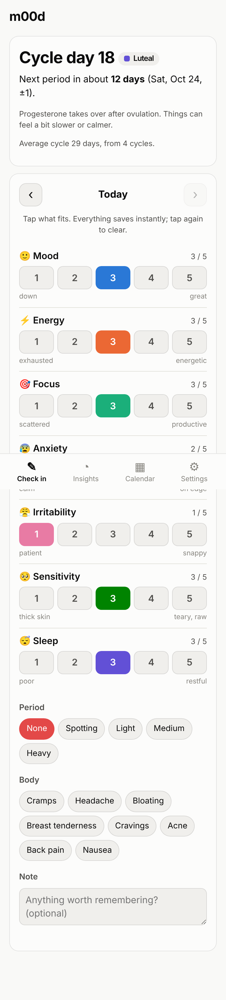
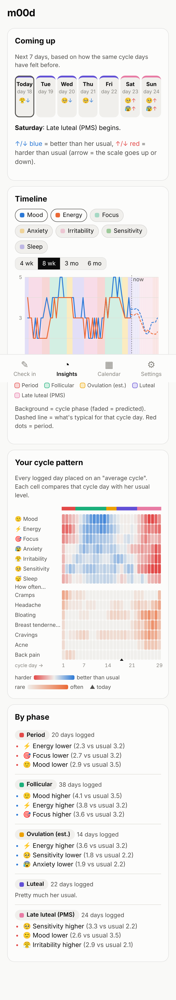
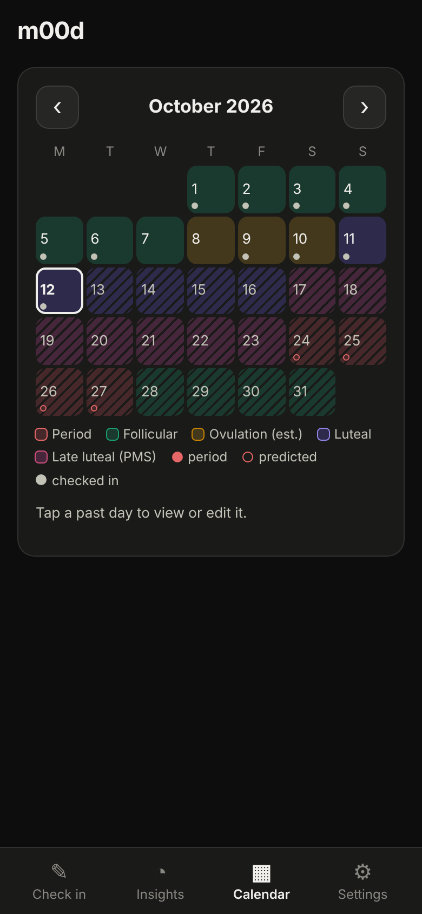

# m00d

A tiny, private mood + menstrual-cycle tracker. Checking in takes about 10 seconds. It shows how moods line up with cycle phases and gives a rough forecast for the next week.

- **No account, no server, no build step.** Plain HTML/CSS/JS. Data is stored only in the browser on the phone it's used on (`localStorage`).
- **Installable.** Open it on a phone and choose "Add to Home Screen". It works offline.
- **Editable.** The mood scales and the list of body symptoms can be changed in Settings.

## Screens

  

| Check in | Insights | Calendar |
|---|---|---|
| Cycle day, phase and next period at the top. Below that, 1–5 taps for each scale, a period-flow row, symptom chips and a note. Saves on every tap. ‹ › to fill in earlier days. | **Coming up**: the next 7 days with phase and the scales that usually run high or low then. **Timeline**: mood lines over phase-colored bands, with a dashed "typical for this cycle day" projection after today. **Cycle pattern**: heatmap of every scale on an "average cycle". **By phase**: plain-language summary. | Month grid colored by phase (striped = predicted), with period and check-in dots. Tap a day to edit it. |

To try it without real data, use **Settings → Load demo data**. It makes up about 4 months of plausible entries. Use **Delete all data** before starting for real.

## What's tracked (defaults)

The 1–5 scales are a trimmed-down version of the **DRSP (Daily Record of Severity of Problems)**, the standard daily form clinicians use to assess PMS/PMDD:

| Scale | 1 → 5 | Direction |
|---|---|---|
| 🙂 Mood | down → great | higher is better |
| ⚡ Energy | exhausted → energetic | higher is better |
| 🎯 Focus | scattered → productive | higher is better |
| 😰 Anxiety | calm → on edge | higher is harder |
| 😤 Irritability | patient → snappy | higher is harder |
| 🥺 Sensitivity | thick skin → teary, raw | higher is harder |
| 😴 Sleep | poor → restful | higher is better |

Body symptoms (tap chips): cramps, headache, bloating, breast tenderness, cravings, acne, back pain, nausea.
Period flow: spotting / light / medium / heavy.

## How the cycle maths works

- **Period start**: the first day with light, medium or heavy flow (not spotting) at least 15 days after the previous start. Gaps of up to 2 days inside a period are tolerated.
- **Cycle length**: the average of the last 6 real cycles. Until two periods are logged, it uses the value in Settings (default 28).
- **Phases** for a cycle of length *L*:
  - Period: the logged bleeding days.
  - Ovulation (estimated): about *L − 14* (luteal length is configurable), ±1 day.
  - Follicular: from the end of the period to ovulation.
  - Luteal: after ovulation.
  - Late luteal / PMS window: the last 7 days before the next period.
- **Predictions** run forward from the last real period. If the period is overdue, the app says how many days late it is instead of pretending it already started.
- **Pattern / forecast**: each logged day is placed on an "average cycle". The luteal half is lined up by *days before the next period*, because that phase is the most consistent. The follicular half is stretched or squeezed to fit. Values are then averaged per cycle day, lightly smoothed with the neighbouring days, and compared to your overall average. The forecast and the dashed projection look up these averages for upcoming days.

Expect useful patterns after 2–3 cycles of fairly regular check-ins. Missing days are fine.

> These are estimates from logged dates, not medical advice, and **not contraception**.

## Running / hosting

Any static file host works.

- **Locally**: `npx http-server .` (or `python3 -m http.server`) and open the printed URL.
- **GitHub Pages** (easiest way to get it on your phone): repo → Settings → Pages → *Deploy from a branch* → pick the branch and `/ (root)`. Open the URL on your phone → Share → *Add to Home Screen*.

The app is public, but the data is not. Each phone keeps its own data, and nothing is sent anywhere.

### Other screens / backups

All the data lives on your phone. To look at it on another screen, use **Settings → Export backup** and import that JSON file on the other device. Exporting now and then is also a good backup. If the browser's site data is cleared, the entries are gone.

## Inspiration

- [**drip**](https://gitlab.com/bloodyhealth/drip): open-source, privacy-first period tracker. It takes the same "your data stays on your phone" approach.
- **Clue / Flo**: the polished commercial cycle trackers. Their phase-colored calendars and predictions are the obvious reference.
- **Daylio**: shows that mood logging only sticks if it's a couple of taps.
- **DRSP** (Endicott et al., 2006): the clinical daily rating form that the default scales are based on.

## Ideas for later

- Sync between two phones (e.g. a tiny backend, or a shared file in cloud storage).
- Several check-ins per day for days with big mood swings.
- Reminder notification in the evening.
- Basal temperature / LH tests for better ovulation estimates.
