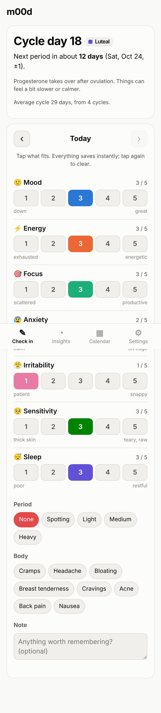
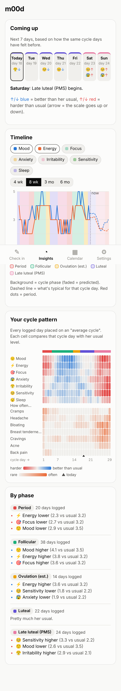
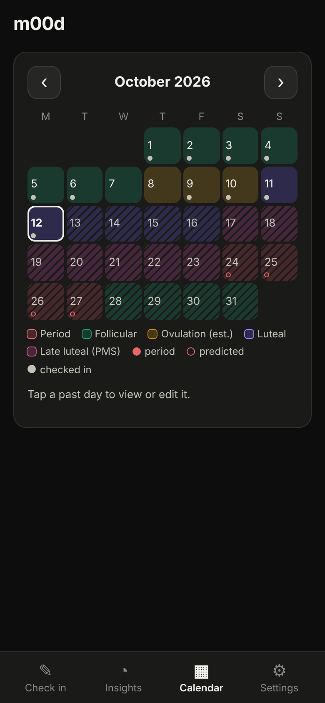

# m00d

A tiny, private mood + menstrual-cycle tracker. Checking in takes about 10 seconds. It shows how moods line up with cycle phases and gives a rough forecast for the next week.

- **No account, no build step.** Plain HTML/CSS/JS. Data is stored in the browser on the phone (`localStorage`).
- **Optional automatic backup to your own server.** A ~150-line Python script (standard library only) keeps a copy, so clearing the browser doesn't lose anything. See [Sync](#sync-backup-to-your-own-server).
- **Installable.** Open it on a phone and choose "Add to Home Screen". It works offline.
- **Editable.** The mood scales and the list of body symptoms can be changed in Settings.

## Screens

  

| Check in | Insights | Calendar |
|---|---|---|
| Cycle day, phase and next period at the top. Below that, 1–5 taps for each scale, a period-flow row, symptom chips and a note. Saves on every tap. ‹ › to fill in earlier days. | **Coming up**: the next 7 days with phase and the scales that usually run high or low then. **Timeline**: mood lines over phase-colored bands, with a dashed "typical for this cycle day" projection after today. **Cycle pattern**: heatmap of every scale on an "average cycle". **By phase**: plain-language summary. | Month grid colored by phase (striped = predicted), with period and check-in dots. Tap a day to edit it. |

To try it without real data, use **Settings → Load demo data**. It makes up about 4 months of plausible entries. Use **Delete all data** before starting for real.

## What's tracked (defaults)

The 1–5 scales are a trimmed-down version of the **DRSP (Daily Record of Severity of Problems)**, the standard daily form clinicians use to assess PMS/PMDD:

| Scale | 1 → 5 | Direction |
|---|---|---|
| 🙂 Mood | down → great | higher is better |
| ⚡ Energy | exhausted → energetic | higher is better |
| 🎯 Focus | scattered → productive | higher is better |
| 😰 Anxiety | calm → on edge | higher is harder |
| 😤 Irritability | patient → snappy | higher is harder |
| 🥺 Sensitivity | thick skin → teary, raw | higher is harder |
| 😴 Sleep | poor → restful | higher is better |

Body symptoms (tap chips): cramps, headache, bloating, breast tenderness, cravings, acne, back pain, nausea.
Period flow: spotting / light / medium / heavy.

## How the cycle maths works

- **Period start**: the first day with light, medium or heavy flow (not spotting) at least 15 days after the previous start. Gaps of up to 2 days inside a period are tolerated.
- **Cycle length**: the average of the last 6 real cycles. Until two periods are logged, it uses the value in Settings (default 28).
- **Phases** for a cycle of length *L*:
  - Period: the logged bleeding days.
  - Ovulation (estimated): about *L − 14* (luteal length is configurable), ±1 day.
  - Follicular: from the end of the period to ovulation.
  - Luteal: after ovulation.
  - Late luteal / PMS window: the last 7 days before the next period.
- **Predictions** run forward from the last real period. If the period is overdue, the app says how many days late it is instead of pretending it already started.
- **Pattern / forecast**: each logged day is placed on an "average cycle". The luteal half is lined up by *days before the next period*, because that phase is the most consistent. The follicular half is stretched or squeezed to fit. Values are then averaged per cycle day, lightly smoothed with the neighbouring days, and compared to your overall average. The forecast and the dashed projection look up these averages for upcoming days.

Expect useful patterns after 2–3 cycles of fairly regular check-ins. Missing days are fine.

> These are estimates from logged dates, not medical advice, and **not contraception**.

## Running / hosting

Any static file host works.

- **Locally**: `npx http-server .` (or `python3 -m http.server`) and open the printed URL.
- **GitHub Pages** (easiest way to get it on your phone): repo → Settings → Pages → *Deploy from a branch* → pick the branch and `/ (root)`. Open the URL on your phone → Share → *Add to Home Screen*.

The app is public, but the data is not. Without sync, each phone keeps its own data and nothing is sent anywhere.

## Sync: backup to your own server

Clearing the browser's site data wipes `localStorage`. Sync keeps a copy on your server so that can't lose anything.

**What it does**

- **Automatic.** About 2 seconds after any change, the app sends the data to the server. It also pulls when it starts and when you switch back to it. If the phone is offline, changes wait and go out later.
- **Safe after a wipe.** The server keeps a revision number and refuses saves based on an older copy. A wiped or outdated phone therefore always pulls first, merges day by day, and then pushes. It can't overwrite newer data with an empty state.
- **Several phones** can use the same server. If two of them edit the same day before syncing, the one that syncs last wins for that day.
- **Copies on the server.** `previous.json` holds the version before the latest save. `snapshots/YYYY-MM-DD.json` holds one copy per day for the last 60 days. All of these live in `server/data/` (or `/var/lib/m00d` with systemd). To roll back, copy a snapshot over `current.json` and restart the server (`docker compose restart`).
- **Status** is shown under Settings → Sync & backup. If nothing has gone through for over a day, or the key is wrong, a banner appears at the top of the app.

**Server setup with Docker + Caddy** (this is how it runs on 100blocks.space; GitHub Pages is HTTPS, so the server has to be too)

The sync server runs as a container on the shared `web` Docker network, and the Caddy container proxies a subdomain to it and handles HTTPS.

```sh
# 1. DNS: point an A record for m00d.your.domain at the server.

# 2. Secret (server/.env is git-ignored)
cd server
mkdir -p data && chmod 700 data
(umask 077; echo "M00D_TOKEN=$(python3 -c 'import secrets; print(secrets.token_urlsafe(32))')" > .env)
# If the app isn't at https://martin-martin.github.io, also add M00D_ORIGIN=https://your.pages.origin to .env

# 3. Start it (restarts automatically; data lands in server/data/)
docker compose up -d --build

# 4. Caddy: add this block to the Caddyfile, then reload
#    m00d.your.domain {
#        reverse_proxy m00d-sync:8787
#    }
docker exec caddy caddy reload --config /etc/caddy/Caddyfile

# Check: should print {"error": "wrong key"}
curl https://m00d.your.domain/data
```

Your sync key is the part after `M00D_TOKEN=` in `server/.env` (`cat server/.env`). After editing `m00d_sync.py`, run `docker compose up -d --build` again.

<details><summary>Without Docker: systemd + nginx</summary>

```sh
sudo mkdir -p /opt/m00d && sudo cp server/m00d_sync.py /opt/m00d/
echo "M00D_TOKEN=<the key>" | sudo tee /etc/m00d-sync.env && sudo chmod 600 /etc/m00d-sync.env
sudo cp server/m00d-sync.service /etc/systemd/system/
sudo systemctl daemon-reload && sudo systemctl enable --now m00d-sync   # data in /var/lib/m00d
# paste server/nginx.conf into your HTTPS server block; the sync URL is then https://your.domain/m00d/data
sudo nginx -t && sudo systemctl reload nginx
```
</details>

**On the phone:** open m00d → Settings → Sync & backup. Enter `https://m00d.your.domain/data` and the key, then tap **Connect**. Data already on the phone is merged into the server copy.

**After a wipe or on a second phone:** on a phone that is already connected, tap **Copy setup link**. Keep the link somewhere private, such as a password manager. It looks like `https://…/m00d/#sync=…&key=…`. Opening it once reconnects the app and pulls everything back. The link contains the key, so treat it like a password.

To test locally: `M00D_TOKEN=devdevdevdevdevdev M00D_ORIGIN=http://localhost:8000 python3 server/m00d_sync.py` plus `python3 -m http.server 8000`, then connect to `http://localhost:8787/data`.

### Manual backups

**Settings → Export backup** saves a JSON file, and **Import backup** loads one. This works with or without sync.

## Inspiration

- [**drip**](https://gitlab.com/bloodyhealth/drip): open-source, privacy-first period tracker. It takes the same "your data stays on your phone" approach.
- **Clue / Flo**: the polished commercial cycle trackers. Their phase-colored calendars and predictions are the obvious reference.
- **Daylio**: shows that mood logging only sticks if it's a couple of taps.
- **DRSP** (Endicott et al., 2006): the clinical daily rating form that the default scales are based on.

## Ideas for later

- Several check-ins per day for days with big mood swings.
- Reminder notification in the evening.
- Basal temperature / LH tests for better ovulation estimates.
